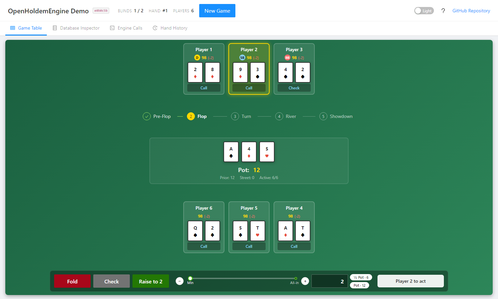

<picture>
  <source media="(prefers-color-scheme: dark)" srcset="docs/assets/wordmark-on-dark-1200.png">
  
</picture>

# TabletopCardEngine

A .NET 10 engine for No-Limit Texas Hold'em cash games. One method, `IHoldemTable.ApplyAsync`, takes a command and returns the whole game as `GameData`. There is no in-memory game object: the database is the state.

[](https://github.com/DigitalAbsurd/TabletopCardEngine/actions/workflows/release.yml) [](https://www.nuget.org/packages/TabletopCardEngine) [](LICENSE) [](https://tabletopcardengine.readthedocs.io/en/stable/)

## Demo

Try the [interactive Blazor WebAssembly demo](https://digitalabsurd.github.io/TabletopCardEngine/): play hands or replay imported hand histories, and watch the database inspector and the engine call log show exactly what each action writes.



## Features and limits

The engine deals and runs No-Limit Texas Hold'em cash games: blinds, betting rounds, side pots, showdown, optimistic concurrency, deterministic dealing for replays, and logs, traces and metrics. Version 1 is limited on purpose: No-Limit Hold'em cash games only, 2 to 6 seats, no antes, no rake. It targets .NET 10 (LTS). What comes next is in the [roadmap](https://tabletopcardengine.readthedocs.io/en/stable/roadmap/).

| Package | Use it for |
|---|---|
| [TabletopCardEngine](https://www.nuget.org/packages/TabletopCardEngine) | The core engine: the `IHoldemTable` interface, the `GameData` DTOs and the schema manager. It references no database provider. |
| [TabletopCardEngine.Sqlite](https://www.nuget.org/packages/TabletopCardEngine.Sqlite) | SQLite storage and its migrations (`UseHoldemSqlite`). Brings the core with it. |
| [TabletopCardEngine.PostgreSql](https://www.nuget.org/packages/TabletopCardEngine.PostgreSql) | PostgreSQL storage and its migrations (`UseHoldemPostgreSql`). |
| [TabletopCardEngine.SqlServer](https://www.nuget.org/packages/TabletopCardEngine.SqlServer) | SQL Server storage and its migrations (`UseHoldemSqlServer`). |
| [TabletopCardEngine.InMemory](https://www.nuget.org/packages/TabletopCardEngine.InMemory) | EF Core in-memory storage (`UseHoldemInMemory`), for tests and demos. |
| [TabletopCardEngine.AspNetCore](https://www.nuget.org/packages/TabletopCardEngine.AspNetCore) | ASP.NET Core integration: configuration binding, a schema health check and the REST API (`MapHoldemApi`). |
| [TabletopCardEngine.OpenTelemetry](https://www.nuget.org/packages/TabletopCardEngine.OpenTelemetry) | `AddTabletopCardEngineInstrumentation()` for OpenTelemetry traces and metrics. |

## Not for real-money gambling

TabletopCardEngine is a game-logic library for learning, simulation, research, testing and
play-money games. It is not intended, designed or certified for real-money gambling. It makes no
claim to meet the requirements a gaming regulator sets for such games, such as a certified random
number generator or a tamper-evident audit trail.

## Quick start

You need the [.NET 10 SDK](https://dotnet.microsoft.com/en-us/download/dotnet/10.0). Docker is needed only for the images.

```bash
dotnet new console -n HoldemQuickStart
cd HoldemQuickStart
dotnet add package TabletopCardEngine.InMemory
```

The InMemory package brings the core package with it. Replace the generated `Program.cs` with:

```csharp
using Microsoft.Extensions.DependencyInjection;
using TabletopCardEngine;
using TabletopCardEngine.Holdem;
using TabletopCardEngine.Holdem.Dto;
using TabletopCardEngine.InMemory;

var services = new ServiceCollection();
services.AddTabletopCardEngine(tce => tce.AddHoldem(db => db.UseHoldemInMemory("holdem")));
using var provider = services.BuildServiceProvider();

// Create or upgrade the schema once, at start-up.
await provider.GetRequiredService<IHoldemSchemaManager>().MigrateAsync();
var table = provider.GetRequiredService<IHoldemTable>();

// A heads-up game: blinds 1/2, two players with 100 each.
var created = await table.ApplyAsync(HoldemAction.CreateGame(new GameOptionData
{
    MaxPlayersCount = 2,
    InitialSmallBlind = 1,
}));
var gameId = created.Value!.GameId;

// StartGame seats the players, deals hand 1 and posts the blinds.
var game = (await table.ApplyAsync(HoldemAction.StartGame(gameId,
[
    new PlayerJoinData("Alice", 1, 100),
    new PlayerJoinData("Bob", 2, 100),
]))).Value!;

// Play the hand to the end: check when allowed, otherwise call.
while (game.HandData!.NextPlayerSeatNo != 0)
{
    var canCheck = game.HandData.Evaluations.Any(e => e.PlayerActionType == PlayerActionType.Check);
    var action = canCheck ? PlayerActionType.Check : PlayerActionType.Call;
    var result = await table.ApplyAsync(HoldemAction.Play(gameId, action));
    if (!result.IsSuccess)
    {
        Console.WriteLine(result.Errors[0].Message);
        return 1;
    }

    game = result.Value!;
}

Console.WriteLine($"Board: {string.Join(" ", game.HandData.CommunityCards)}");
foreach (var seat in game.HandData.Seats)
{
    // Stack excludes the winnings until the next hand; the outcome is HandResult.Net.
    var net = seat.HandResult!.Net;
    Console.WriteLine($"{seat.Name}: {string.Join(" ", seat.Hole ?? [])}, {seat.HandResult.Description}, {net:+0;-0;0}");
}

return 0;
```

Run it with:

```bash
dotnet run
```

The [getting started guide](https://tabletopcardengine.readthedocs.io/en/stable/getting-started/) explains each step.

## Usage

### The command and `GameData` loop

Every call sends a `HoldemAction` and gets the whole game back. `HandData.Evaluations` lists what the player on the clock may do, `HandData.NextPlayerSeatNo` names that player (`0` when nobody acts), and an optional `ExpectedVersion` on the action turns a stale write into a `Conflict`. See [Key concepts](https://tabletopcardengine.readthedocs.io/en/stable/concepts/).

### REST API

The `TabletopCardEngine.AspNetCore` package binds the engine's options from configuration and maps the REST API:

```csharp
builder.Services.AddTabletopCardEngine(tce => tce.AddHoldem(
    builder.Configuration.GetSection("TabletopCardEngine:Holdem"),
    db => db.UseHoldemSqlite(builder.Configuration.GetConnectionString("TabletopCardEngine")!)));

app.MapHoldemApi();
```

See [ASP.NET Core](https://tabletopcardengine.readthedocs.io/en/stable/aspnetcore/).

### Docker images

Images for SQLite, PostgreSQL and SQL Server run the same REST API:

```bash
docker run -d -p 8080:8080 -v holdem-data:/data digitalabsurd/tabletopcardengine:sqlite
```

There is no API authentication in the container, so run the image on a trusted network or behind an authenticating reverse proxy. See [Container images](https://tabletopcardengine.readthedocs.io/en/stable/docker/).

## Configuration

The container host reads these settings from the environment:

| Setting | Meaning |
|---|---|
| `ConnectionStrings__TabletopCardEngine` | The connection string of the database, required. |
| `TabletopCardEngineServer__Provider` | The database provider: `Sqlite`, `PostgreSql` or `SqlServer`, required. |
| `TabletopCardEngine__Holdem__*` | Hold'em's host options, such as `GamePlayersMinCount` and `MigrateDatabaseOnStartup`. |

The details are in [Configuration](https://tabletopcardengine.readthedocs.io/en/stable/docker/#configuration).

## Contributing

- [CONTRIBUTING.md](CONTRIBUTING.md) explains how to build, test and propose a change.
- [CODE_OF_CONDUCT.md](CODE_OF_CONDUCT.md) sets the standard of behaviour in the project's spaces.
- [SECURITY.md](SECURITY.md) says how to report a vulnerability privately.

## License

TabletopCardEngine is released under the [Apache License, Version 2.0](LICENSE). Commercial use
is allowed. Anyone who redistributes the engine or a work derived from it must keep the attribution
in [NOTICE](NOTICE), as section 4(d) of the license requires.
[ADR-0001](docs/adr/0001-project-license.md) explains why this license was chosen.

The licenses and notices of the third-party packages it depends on, of the assets the demo
redistributes, and of the vendored PHH hand-history corpus are in
[THIRD-PARTY-NOTICES.md](THIRD-PARTY-NOTICES.md).

The TabletopCardEngine name, logo and wordmark are DigitalAbsurd's and are not covered by the Apache
License: the [project artwork](THIRD-PARTY-NOTICES.md#project-artwork) section says which files they
are and how they may be used.
