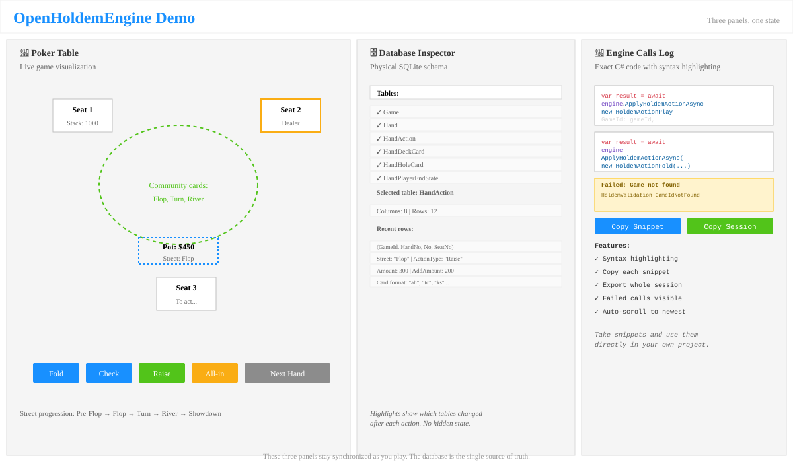

# OpenHoldemEngine Blazor WebAssembly Demo

An interactive guide to the `OpenHoldemEngine` library running live in the browser. Play Texas Hold'em hands or replay recorded hand histories, and watch as the three panels move in lockstep:

- **The poker table**: Live visualization of each player's cards, position, stack, and actions
- **The database inspector**: The physical SQLite schema and rows the engine writes (the state)
- **The engine calls log**: The exact C# code (`ApplyHoldemActionAsync` calls) that produced every table change

**Try it live**: https://miekhra.github.io/OpenHoldemEngine/



## What this demo teaches

The central lesson of `OpenHoldemEngine` is that **there is no in-memory game object — the database is the state**. Every action in the library follows the same path:

1. Load the game aggregate from the database
2. Mutate the EF entity graph by calling a handler for the action
3. Write the changes back to the database
4. Return the newly-projected `GameData` to the caller

The demo proves this by showing you the exact tables and rows the engine creates, and the exact C# code that created them, all updated live as you play. This is the strongest evidence that the engine is deterministic and correct, and the quickest way to understand what it does.

A visitor who has never seen the repository should be able to open the link above, spend two minutes on the walkthrough, play one hand, and explain back what the three panels are showing.

## Running locally

### Prerequisites

- .NET 10 SDK
- The `wasm-tools` workload (for native SQLite in WebAssembly)

### Install the workload

```bash
dotnet workload restore
```

This installs the Emscripten toolchain and build tools required for native library compilation in WebAssembly.

## Building

### Prerequisites

- .NET 10 SDK
- The `wasm-tools` workload (for native SQLite in WebAssembly)

### Install the workload

```bash
dotnet workload restore
```

This installs the Emscripten toolchain and build tools required for native library compilation in WebAssembly.

### Build in Debug configuration

```bash
dotnet build
```

### Publish in Release configuration

```bash
dotnet publish -c Release
```

The publish output goes to `bin/Release/net10.0/publish/`.

## Running the demo

### Development server

```bash
dotnet watch run
```

This launches the Blazor dev server and watches for changes.

### Accessing the demo

Once running, open the demo in your browser at `http://localhost:5170` (HTTP profile) or `https://localhost:7226` (HTTPS profile).

After you are done, stop the development server by pressing `Ctrl+C` in the terminal where it is running. Verify no process is listening on ports 5170 or 7226 with:

```powershell
Get-NetTCPConnection -LocalPort 5170,7226 -State Listen -ErrorAction SilentlyContinue |
    Select-Object LocalPort, OwningProcess
```

An empty result means the ports are free and the server has stopped.

## Known limitations

### Database lives in memory only

The demo stores every game in your browser's memory, not on disk:

- **No persistence across reloads**: If you reload the page, the current game is lost completely.
- **No tab switching**: Closing the tab, or navigating away and back, discards the game.
- **`.phh` export is your backup**: Use the "Export hand as .phh" button in the right panel to download the current hand as a text file, which you can re-import later or share.

This is a deliberate design choice. Persisting SQLite to browser storage (LocalStorage, IndexedDB, or OPFS) adds complexity that does not teach anything about the engine. The in-memory approach keeps the demo self-contained and fast, while still demonstrating that the engine separates the game state (database) from the application (handlers and queries).

## Troubleshooting and diagnostics

If the demo does not respond:

1. Open your browser's Developer Tools (F12), then the **Console** tab, and look for JavaScript errors.
2. Check the **Network** tab for failed asset loads or slow downloads.
3. If the engine is crashing, you may see an unhandled C# exception in the console.

### Verify the engine with the diagnostics page

Run the demo locally with `dotnet watch run`, then navigate to `http://localhost:5170/diagnostics` (or `https://localhost:7226/diagnostics` if using the HTTPS profile).

This page:
1. Creates a test game via `HoldemEngine.ApplyHoldemActionAsync`
2. Queries the SQLite database directly to list all nine engine tables

If you see the nine table names, the engine is working correctly.

## Performance metrics

These measurements are from the current build configuration and serve as a baseline for detecting regressions in future changes.

### Published size (Release configuration)

- **Total: ~53.4 MB**
  - Blazor framework and runtime: ~20 MB (dotnet.js, dotnet.runtime.js, dotnet.native.wasm, ICU data)
  - .NET assemblies and dependencies: ~20 MB
  - SQLite and EF Core: ~6 MB

The large published size is a known characteristic of Blazor WebAssembly applications. The Emscripten-built native SQLite binary contributes significantly to this.

### Cold-start time

Cold-start latency is dominated by:

1. **Initial load**: Network download of the .wasm file and IL→JIT compilation
2. **Database schema creation**: `IHoldemSchemaManager.MigrateAsync()` applies the shipped SQLite migrations on app startup

## Architecture

### DemoEngineHost

`Engine/DemoEngineHost.cs` configures the engine for WebAssembly:

- Creates and opens a kept-alive `SqliteConnection` with `DataSource=:memory:`
- Registers it with dependency injection as both the EF Core provider (`UseHoldemSqlite(connection)`) and a singleton for direct access
- Does not create the schema: `Program.Main` builds the host, awaits `IHoldemSchemaManager.MigrateAsync()` once for both engines, then runs it. `OpenHoldemEngine.Sqlite` is a trimmer root in the project file, because EF finds its migrations by reflection and a trimmed publish would otherwise arrive with none
- The inspector therefore also lists `__OheMigrationsHistory` and `__OheSchema`, which "New Game" does not clear
- Registers a second engine, `DemoReplayEngine`, in a container of its own with the `PhhCardShuffler` installed, over the same connection. `DemoGameSession` switches to it for a replay and back to the play engine afterwards, since engine options belong to the container and are never reconfigured in place

The kept-alive connection is critical: without it, each new `DbContext` instance would see an empty in-memory SQLite database (each connection has its own in-memory database).

### Diagnostics page

`Pages/Diagnostics.razor` verifies the engine is working:

1. Creates a game via `HoldemEngine.ApplyHoldemActionAsync(HoldemActionCreateGame, ...)`
2. Queries `sqlite_master` directly to list the engine's tables
3. Displays the nine tables the engine creates

## Known limitations and warnings

### SQLite varargs in WebAssembly

The WASM build produces warnings about SQLite varargs (`sqlite3_config`, `sqlite3_db_config`):

```
Found a native function (sqlite3_config) with varargs in e_sqlite3. Calling such functions is not supported, and will fail at runtime.
```

This is a tooling limitation (Emscripten cannot generate correct calling conventions for varargs functions in WASM). These specific functions are not called by the engine or EF Core in normal operation, so the warnings are informational. If a call to one of these functions is attempted at runtime, it will fail with a clear error.

## Attribution

### PHH Dataset

The sample hand histories bundled in `wwwroot/sample/` are derived from the **PHH dataset** (Poker Hand Histories).

- **Source**: https://github.com/uoftcprg/phh-dataset
- **License**: MIT
- **Copyright**: Universal, Open, Free, and Transparent Computer Poker Research Group

The full license text is available in `wwwroot/sample/LICENSE-phh-dataset.txt`.

### Everything else the site ships

Publishing copies the repository's `THIRD-PARTY-NOTICES.md` to the root of the site, next to
`index.html`. It covers Ant Design Blazor, Tomlyn, SQLite, PrismJS, the .NET WebAssembly runtime and
every other package or asset the demo redistributes.

## Troubleshooting

### "wasm-tools workload not installed"

Run `dotnet workload restore` in the repository root.

### "The engine is not responding" in the diagnostics page

This usually indicates a JavaScript error or an unhandled exception in the C# code. Check the browser console (F12 Developer Tools) for details.

### Build failures with native compilation

The WASM native build can be fragile. If you encounter linker errors or unexpected warnings:

1. Clean everything: `dotnet clean && rm -r bin obj`
2. Restore workloads: `dotnet workload restore`
3. Build again: `dotnet build`

If issues persist, check the [Emscripten documentation](https://emscripten.org/docs/) and the [Blazor WebAssembly documentation](https://learn.microsoft.com/en-us/aspnet/core/blazor/webassembly).
